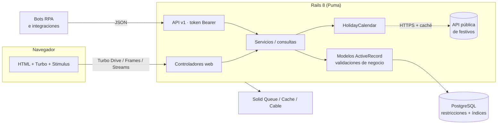
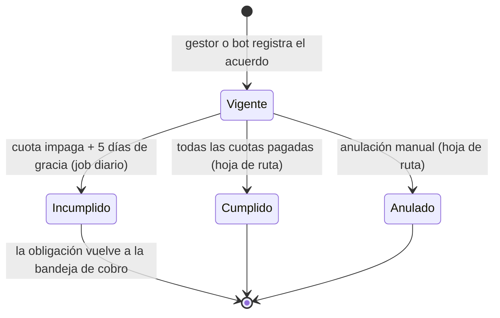

# Arquitectura

Monolito Rails 8 "a la Rails" (*majestic monolith*): una sola aplicación con interfaz web
renderizada en el servidor (Hotwire) y una API JSON para integraciones, sobre PostgreSQL.



## Capas

| Capa | Ubicación | Responsabilidad |
|---|---|---|
| Controladores | `app/controllers` | HTTP delgado: parámetros, autorización, formato de respuesta |
| API | `app/controllers/api/v1`, `app/views/api/v1/*.jbuilder` | Autenticación por token, errores uniformes, límite de solicitudes |
| Casos de uso | `app/services/register_payment_agreement.rb` | Transacciones e idempotencia |
| Dominio | `app/models` | Reglas de negocio (cobertura del acuerdo, promesas, franjas de mora) |
| Integraciones | `app/services/holiday_calendar.rb`, `colombian_holidays.rb` | API externa con *timeouts* y caché; respaldo calculado por ley para cualquier año |
| Consultas | `app/queries/portfolio_summary.rb` | Agregaciones del tablero en SQL (sin cargar registros) |
| Interfaz | `app/views`, `app/javascript/controllers` | Turbo Frames/Streams y 6 controladores Stimulus |

## Hotwire en la práctica

| Interacción | Técnica |
|---|---|
| Búsqueda de clientes mientras se escribe | Turbo Frame `clients` + Stimulus `debounce-submit` + `turbo_action: advance` (la URL refleja el filtro) |
| Registrar gestión sin recargar | Turbo Stream: `prepend` al historial, `replace` del formulario, `update` del flash |
| Campos de promesa condicionales | Stimulus `promise-fields` (muestra y vuelve obligatorios fecha y valor) |
| Plan de cuotas con festivos | Botón con `formaction` → Turbo Stream `replace` de la tabla de cuotas calculada en el servidor |
| Cuotas dinámicas | Stimulus `nested-form` (filas desde `<template>`, `_destroy`, renumeración) + `agreement-total` (suma en vivo) |
| Navegación | Turbo Drive con *morphing* y preservación del scroll |

## Integridad de datos en dos niveles

Cada regla crítica existe en el modelo (mensaje claro al usuario) **y** en la base de datos
(garantía ante bugs, consolas o integraciones que salten validaciones):

| Regla | Modelo | PostgreSQL |
|---|---|---|
| Un solo acuerdo vigente por obligación | `validate :single_active_agreement` | Índice único **parcial** `WHERE status = 'active'` |
| Promesa con fecha y valor | `with_options if: :promise_to_pay?` | `CHECK (outcome <> 'promise_to_pay' OR (… IS NOT NULL AND promise_amount > 0))` |
| Enums válidos | `enum … validate: true` | `CHECK (status IN (…))` en cada tabla |
| Documento de 6 a 10 dígitos | `format:` | `CHECK (document_number ~ '^[0-9]{6,10}$')` |
| Saldos y montos no negativos | `numericality` | `CHECK (principal_balance >= 0)`, `amount > 0` |
| Idempotencia de acuerdos | `RegisterPaymentAgreement` | Índice único sobre `reference` |

La búsqueda por nombre usa un índice **GIN con trigramas** (`pg_trgm`) para que
`ILIKE '%texto%'` no recorra toda la tabla.

## Mora y ciclo de vida del acuerdo

Los días de mora no se escriben a mano: se derivan de `past_due_since` (vencimiento impago más
antiguo). `days_past_due` es un valor materializado para ordenar e indexar la bandeja de cobro, y
`RefreshDelinquencyJob` lo recalcula cada madrugada con un solo `UPDATE` que solo toca las filas que
cambian. El mismo job declara incumplidos los acuerdos con cuotas vencidas hace más de 5 días.



## Modelo de datos

```mermaid
erDiagram
    users ||--o{ collection_activities : registra
    users ||--o{ payment_agreements : registra
    users ||--o{ api_tokens : posee
    clients ||--o{ obligations : tiene
    obligations ||--o{ collection_activities : recibe
    obligations ||--o{ payment_agreements : tiene
    payment_agreements ||--|{ installments : "se paga en"
    clients { string document_number UK; string full_name; string city; string segment }
    obligations { string number UK; string product; decimal principal_balance; int days_past_due; date past_due_since; string status }
    collection_activities { string channel; string outcome; datetime occurred_at; date promise_date; decimal promise_amount; string source }
    payment_agreements { string reference UK; decimal total_amount; string status }
    installments { int number; date due_on; decimal amount; datetime paid_at }
    api_tokens { string token_digest UK; datetime last_used_at; datetime revoked_at }
```

## Decisiones

| ADR | Decisión |
|---|---|
| [0001](adr/0001-hotwire-en-lugar-de-spa.md) | Hotwire (HTML desde el servidor) en lugar de una SPA |
| [0002](adr/0002-reglas-en-modelo-y-base.md) | Reglas críticas en el modelo **y** en PostgreSQL |
| [0003](adr/0003-calendario-de-festivos-con-respaldo.md) | Festivos desde una API pública con respaldo calculado por ley |
| [0004](adr/0004-tokens-de-api-con-hash.md) | Tokens de API aleatorios guardados como SHA-256 |
